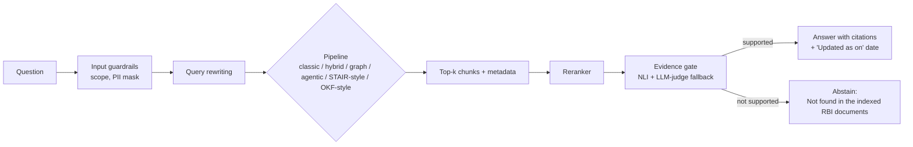

# RegRAG

**A local, evidence-gated RAG benchmark over RBI Master Directions.**
Which RAG design answers Indian banking-regulation questions best, and what does each improvement actually add?

> **Status: early development (updated 2026-11-04).** Classic and hybrid pipelines are written and have only been smoke-tested on a few questions. A first **retrieval-only** check exists (see below). **No end-to-end benchmark has been run yet**, so the pipeline results tables stay empty on purpose; they will be filled only with measured numbers.

## Why this project

Banking regulation is a hard test for RAG: long documents, chapters and clauses that cross-reference each other, tables, amendments, and answers where a wrong or unsupported reply is costly. Most RAG demos show one pipeline working. RegRAG instead **measures** several designs on the same questions and reports where each one wins and fails.

Principles:
- **Measure, don't claim.** Every technique is added one at a time with a before/after score.
- **Abstain over guess.** An evidence gate refuses to answer when the sources don't support it.
- **Local first.** Query time runs on a CPU-only laptop (Ollama). Cloud models are optional, only for one-time indexing or judging, and flagged wherever used.
- **Honest evaluation.** Every golden question is checked against the source PDF page. The checker is an LLM (Claude), not a human, and the README says so.

## What it compares

| # | Pipeline | Idea |
|---|---|---|
| 1 | Classic RAG | Embed chunks, vector search, answer |
| 2 | Hybrid RAG | BM25 + dense search, RRF fusion, reranker |
| 3 | Graph RAG | [LightRAG](https://github.com/HKUDS/LightRAG) knowledge graph + vector retrieval |
| 4 | Agentic RAG | Route, retrieve, evaluate, refine loop |
| 5 | STAIR-inspired | Retrieval guided by a document's table of contents (inspired by IBM's STAIR paper) |
| 6 | OKF-style | Curated Markdown knowledge bundle instead of a vector index (inspired by Google's Open Knowledge Format) |

Pipelines 5 and 6 are **light re-implementations of the ideas, not the official code**. I will read the original papers and specs before claiming anything about them.

## Planned architecture



## Improvement techniques (measured one at a time)

1. Smart chunking (by chapter and clause)
2. Metadata (document, chapter, date, amended flag)
3. Hybrid search (keyword + semantic)
4. Query rewriting
5. Reranking
6. Strict prompt (answer only from sources)

## Guardrails

Configured in `config.yaml`. Implemented in code (`guardrails.py`, `pipelines/rag.py`, unit-tested with fake models; not yet measured end to end):
- Answer only from the indexed RBI documents; every claim needs a document and page citation, otherwise abstain
- No legal, compliance or financial advice; the system explains what a rule says
- Always show the document's "Updated as on" date, and warn when it is stale
- Treat retrieved text as data, never as instructions (prompt-injection defence)
- Mask personal numbers (Aadhaar, PAN, phone, account) in inputs and logs
- Refuse off-topic questions

A safety test set (`evals/golden/safety_seed.yaml`, 20 items covering advice, off-topic, injection, unanswerable, PII and stale-source questions) is checked by rule-based heuristics in `src/regrag/evals/safety.py`. **It has not been run against a real model yet, so no pass rate is reported.** The items were written by an LLM and not reviewed by a human; injection through retrieved documents is not covered yet.

## Evaluation plan

- **Golden set:** ~100 questions drafted with an LLM from the documents and **checked against the PDFs by an LLM (Claude); not hand-verified by a human**. Each is tagged: `lookup`, `table`, `multi-hop`, `amendment`, `unanswerable`.
- **Metrics:** [RAGAS](https://github.com/explodinggradients/ragas) (faithfulness, answer relevancy, context precision/recall) and [DeepEval](https://github.com/confident-ai/deepeval), run in GitHub Actions with thresholds.
- **Judge check:** no human labels exist yet, so no judge-vs-human agreement (Cohen's kappa) is reported. If I hand-check a random sample later, kappa will be computed on that sample only.
- **Cost and speed:** latency per question on a CPU-only machine.

### Retrieval check (exploratory, not a benchmark)

Does the top-k contain the gold page? 26 answerable questions, all from the KYC Directions, searched over a 4-document, 373-chunk corpus (KYC + 3 small Master Directions; the 412-page capital adequacy PDF is not indexed yet). Cells are recall as `strict / loose`: *strict* = the chunk starts on a gold page, *loose* = the chunk's assumed page span covers a gold page. Multi-hop counts a hit if any one gold page is found.

| Retriever | @1 | @5 | @20 |
|---|---|---|---|
| BM25 | 0.58 / 0.69 | 0.85 / 0.96 | 0.92 / 0.96 |
| Dense (bge-m3) | 0.58 / 0.69 | 0.88 / 0.92 | 0.96 / 1.00 |
| Hybrid (BM25 + dense, RRF) | 0.69 / 0.88 | 0.92 / 0.96 | 0.92 / 0.96 |
| Hybrid + reranker (bge-reranker-v2-m3) | 0.69 / 0.85 | 0.92 / 0.96 | 0.92 / 0.96 |

How far to trust it: only 26 questions (one question is about 4 points), a small corpus, questions written from the document's own wording, gold pages checked by an LLM and not a human, and a page hit does not prove the answer text reached the model. Treat the differences between rows as noise. The reranker only reorders the same 20 candidates, so it cannot raise recall at 20.

Generation smoke test (no scores): with a small model (`qwen3:1.7b`, used because of low RAM), 1 lookup question was answered correctly with a page citation, 3 unanswerable questions were correctly refused, and 1 multi-hop question was wrongly refused. This is 5 questions, not a measurement.

### Results

_Not measured yet._

| Pipeline | Faithfulness | Answer relevancy | Context precision | Context recall | Abstain accuracy | Latency (s) |
|---|---|---|---|---|---|---|
| Classic | - | - | - | - | - | - |
| Hybrid | - | - | - | - | - | - |
| Graph (LightRAG) | - | - | - | - | - | - |
| Agentic | - | - | - | - | - | - |
| STAIR-inspired | - | - | - | - | - | - |
| OKF-style | - | - | - | - | - | - |

| Technique added | Faithfulness change | Context recall change |
|---|---|---|
| Baseline | - | - |
| + Smart chunking | - | - |
| + Metadata | - | - |
| + Hybrid search | - | - |
| + Query rewriting | - | - |
| + Reranking | - | - |
| + Strict prompt | - | - |

## Stack (planned)

Python 3.11+, Ollama (`qwen3:4b`), `BAAI/bge-m3` embeddings, `BAAI/bge-reranker-v2-m3`, ChromaDB, rank-bm25, LightRAG, Docling for tables, FastAPI, RAGAS, DeepEval.

## Repository layout

```
src/regrag/      ingestion, chunking, embeddings, vectordb, retrieval,
                 pipelines, gate, llm, evals, api, utils
scripts/         register_pdfs.py (update MANIFEST.json), build_index.py (embed into Chroma),
                 run_eval.py (staged benchmark / safety runner)
tests/           40 unit tests (chunker, BM25, hybrid fusion, RAG pipeline, guardrails, gate, rewriting, agentic retriever, eval runners)
evals/golden/    question sets: seed_kyc.yaml (30 questions), safety_seed.yaml
data/raw/        RBI PDFs (not committed) + MANIFEST.json (source, date, checksum)
docs/PLAN.md     decisions and milestones
config.yaml      models, chunking, retrieval, gate and guardrail settings
```

## Data and sources

Documents are RBI Master Directions from the official RBI website (public). The PDFs are **not** stored in this repo. `data/raw/MANIFEST.json` records each file's source URL, retrieval date, page count and SHA-256. RBI blocks scripted downloads, so files are saved by hand. See `data/SAMPLE_URLS.md` for the starter list.

## Roadmap

- [x] Plan, config, project skeleton, guardrail settings
- [ ] Corpus of 30-50 RBI documents (5 of 14 starter files collected; 4 indexed, the 412-page one is not yet)
- [ ] Classic and hybrid baselines (code and runner `scripts/run_eval.py` written; the full benchmark has not been run; the runner reports abstain accuracy, citation-page hit rate and latency, and answer correctness still needs a judge)
- [ ] Golden set (30 seed questions drafted and LLM-checked; then ~100)
- [ ] Graph and agentic pipelines (agentic: decompose, retrieve, check evidence, refine; written and unit-tested with fakes, never run on real models. Graph (LightRAG) deferred until a cloud key or a bigger machine is chosen)
- [ ] Evidence gate and ablation (gate with NLI + LLM-judge fallback written and unit-tested with fakes; modes none / llm_judge / nli_plus_judge; optional number-grounding check added from the reading list in `docs/RESEARCH.md`, tested with fakes only; `reranker_threshold` mode written (abstains before generation when the top reranker score is low; the threshold is not tuned yet and no ablation has been run))
- [ ] Table/figure ingestion
- [ ] STAIR-inspired and OKF-style pipelines
- [ ] RAGAS + DeepEval in CI, results tables, diagrams

Later: Hinglish queries, video RAG.

## Disclaimer

This is a research and portfolio project. It is not legal, compliance or financial advice. Always check the current text on [rbi.org.in](https://www.rbi.org.in).

## Author

Harshal Bhambhani, [portfolio](https://harshaaalll.github.io/) · [GitHub](https://github.com/Harshaaalll)
