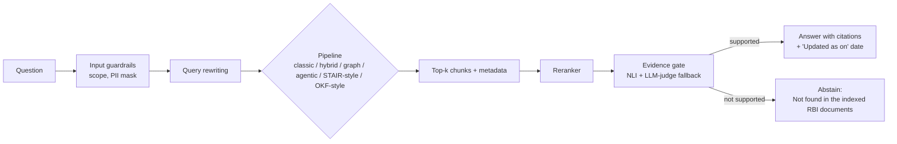

# RegRAG

**A local, evidence-gated RAG benchmark over RBI Master Directions.**
Which RAG design answers Indian banking-regulation questions best, and what does each improvement actually add?

> **Status: early development.** The plan, config and guardrails are in place. No pipeline is implemented yet, and **there are no results yet**. The results tables below are empty on purpose; they will be filled only with measured numbers.

## Why this project

Banking regulation is a hard test for RAG: long documents, chapters and clauses that cross-reference each other, tables, amendments, and answers where a wrong or unsupported reply is costly. Most RAG demos show one pipeline working. RegRAG instead **measures** several designs on the same questions and reports where each one wins and fails.

Principles:
- **Measure, don't claim.** Every technique is added one at a time with a before/after score.
- **Abstain over guess.** An evidence gate refuses to answer when the sources don't support it.
- **Local first.** Query time runs on a CPU-only laptop (Ollama). Cloud models are optional, only for one-time indexing or judging, and flagged wherever used.
- **Honest evaluation.** The question set is checked by hand, and the LLM judge is compared against human labels.

## What it compares

| # | Pipeline | Idea |
|---|---|---|
| 1 | Classic RAG | Embed chunks, vector search, answer |
| 2 | Hybrid RAG | BM25 + dense search, RRF fusion, reranker |
| 3 | Graph RAG | [LightRAG](https://github.com/HKUDS/LightRAG) knowledge graph + vector retrieval |
| 4 | Agentic RAG | Route, retrieve, evaluate, refine loop |
| 5 | STAIR-inspired | Retrieval guided by a document's table of contents (inspired by IBM's STAIR paper) |
| 6 | OKF-style | Curated Markdown knowledge bundle instead of a vector index (inspired by Google's Open Knowledge Format) |

Pipelines 5 and 6 are **light re-implementations of the ideas, not the official code**. I will read the original papers and specs before claiming anything about them.

## Planned architecture



## Improvement techniques (measured one at a time)

1. Smart chunking (by chapter and clause)
2. Metadata (document, chapter, date, amended flag)
3. Hybrid search (keyword + semantic)
4. Query rewriting
5. Reranking
6. Strict prompt (answer only from sources)

## Guardrails

Configured in `config.yaml` (enforcement code not written yet):
- Answer only from the indexed RBI documents; every claim needs a document and page citation, otherwise abstain
- No legal, compliance or financial advice; the system explains what a rule says
- Always show the document's "Updated as on" date, and warn when it is stale
- Treat retrieved text as data, never as instructions (prompt-injection defence)
- Mask personal numbers (Aadhaar, PAN, phone, account) in inputs and logs
- Refuse off-topic questions

A safety test set (`evals/golden/safety_seed.yaml`, target ~20 items covering advice, off-topic, injection, unanswerable, PII and stale-source questions) will report a pass rate here.

## Evaluation plan

- **Golden set:** ~100 questions drafted with an LLM from the documents and **hand-verified in full by me**. Each is tagged: `lookup`, `table`, `multi-hop`, `amendment`, `unanswerable`.
- **Metrics:** [RAGAS](https://github.com/explodinggradients/ragas) (faithfulness, answer relevancy, context precision/recall) and [DeepEval](https://github.com/confident-ai/deepeval), run in GitHub Actions with thresholds.
- **Judge check:** agreement between the LLM judge and my labels (Cohen's kappa).
- **Cost and speed:** latency per question on a CPU-only machine.

### Results

_Not measured yet._

| Pipeline | Faithfulness | Answer relevancy | Context precision | Context recall | Abstain accuracy | Latency (s) |
|---|---|---|---|---|---|---|
| Classic | - | - | - | - | - | - |
| Hybrid | - | - | - | - | - | - |
| Graph (LightRAG) | - | - | - | - | - | - |
| Agentic | - | - | - | - | - | - |
| STAIR-inspired | - | - | - | - | - | - |
| OKF-style | - | - | - | - | - | - |

| Technique added | Faithfulness change | Context recall change |
|---|---|---|
| Baseline | - | - |
| + Smart chunking | - | - |
| + Metadata | - | - |
| + Hybrid search | - | - |
| + Query rewriting | - | - |
| + Reranking | - | - |
| + Strict prompt | - | - |

## Stack (planned)

Python 3.11+, Ollama (`qwen3:4b`), `BAAI/bge-m3` embeddings, `BAAI/bge-reranker-v2-m3`, ChromaDB, rank-bm25, LightRAG, Docling for tables, FastAPI, RAGAS, DeepEval.

## Repository layout

```
src/regrag/      ingestion, chunking, embeddings, vectordb, retrieval,
                 pipelines, gate, llm, evals, api, utils
evals/golden/    question sets (including the safety seed)
data/raw/        RBI PDFs (not committed) + MANIFEST.json (source, date, checksum)
docs/PLAN.md     decisions and milestones
config.yaml      models, chunking, retrieval, gate and guardrail settings
```

## Data and sources

Documents are RBI Master Directions from the official RBI website (public). The PDFs are **not** stored in this repo. `data/raw/MANIFEST.json` records each file's source URL, retrieval date, page count and SHA-256. RBI blocks scripted downloads, so files are saved by hand. See `data/SAMPLE_URLS.md` for the starter list.

## Roadmap

- [x] Plan, config, project skeleton, guardrail settings
- [ ] Corpus of 30-50 RBI documents (1 of 14 starter files collected)
- [ ] Classic and hybrid baselines
- [ ] Golden set (30 seed questions, then ~100)
- [ ] Graph and agentic pipelines
- [ ] Evidence gate and ablation
- [ ] Table/figure ingestion
- [ ] STAIR-inspired and OKF-style pipelines
- [ ] RAGAS + DeepEval in CI, results tables, diagrams

Later: Hinglish queries, video RAG.

## Disclaimer

This is a research and portfolio project. It is not legal, compliance or financial advice. Always check the current text on [rbi.org.in](https://www.rbi.org.in).

## Author

Harshal Bhambhani, [portfolio](https://harshaaalll.github.io/) · [GitHub](https://github.com/Harshaaalll)
